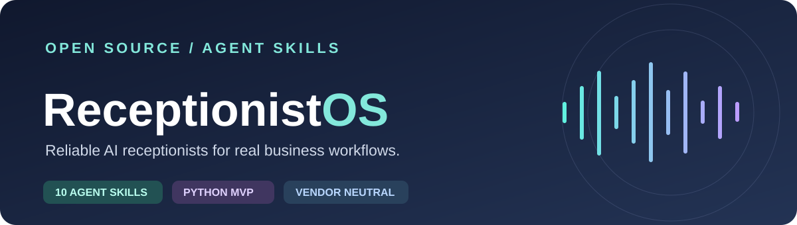
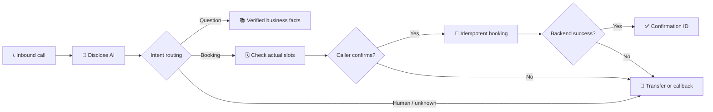

<div align="center">



<br />

**Build AI receptionists that don't just sound smart — they handle business actions responsibly.**

<sub>Composable agent skills · Deterministic booking safeguards · Human-first escalation · Vendor-neutral foundations</sub>

<br /><br />

[](https://github.com/nguyenbui1105/ai-receptionist-skills/actions/workflows/test.yml)
[](https://www.python.org/)
[](LICENSE)
[](skills/)
[](docs/PRODUCTION.md)

**[Explore Skills](skills/README.md)** · **[Run Demo](#-try-the-offline-demo)** · **[Architecture](docs/ARCHITECTURE.md)** · **[Roadmap](#-roadmap)** · **[Contribute](CONTRIBUTING.md)**

</div>

---

## ✨ What is ReceptionistOS?

**ReceptionistOS** is an **open-source AI receptionist skill collection + reference orchestration layer** for appointment-driven businesses. It turns common phone workflows into clear, testable agent instructions and backend rules.

A real AI receptionist needs more than a charming voice: it must know when it is uncertain, verify availability, obtain approval **before** changing records, and gracefully hand off to humans. That's the engineering focus here.

> [!IMPORTANT]
> **Foundation MVP, not a hosted calling service.** The included Python demo uses fictional business data and an in-memory calendar. It does **not** connect real phone calls, send SMS, or book customer appointments.

### 🎯 Built for

| 🏢 Business | Example tasks |
| :--- | :--- |
| 🚗 Auto service | Service intake, appointment requests, vehicle details, human escalation |
| 💐 Florists | Store hours, order inquiries, pickup/delivery request intake |
| 💇 Salons & spas | Service explanations, booking and rescheduling |
| 🛠️ Home services | Request qualification, appointment windows, callbacks |
| 🧰 Other SMBs | A configurable, business-grounded voice workflow |

*Do not use in regulated or emergency settings without additional, domain-specific controls and professional review.*

## 🧭 From phone call to verified action



**The core promise:** the agent may *offer* an appointment, but it can only say *confirmed* after the calendar has actually committed the booking.

## 🧩 Skill library

Each skill lives in its own `SKILL.md` and documents **triggers → inputs → process → fallback → acceptance criteria**.

| Skill | Responsibility |
| :--- | :--- |
| [🪪 Identity disclosure](skills/identity-disclosure/SKILL.md) | Clearly identify the AI assistant |
| [🧭 Intake & routing](skills/intake-routing/SKILL.md) | Capture intent without rigid phone trees |
| [📚 Business knowledge](skills/business-knowledge/SKILL.md) | Answer only from verified business facts |
| [📅 Appointment scheduling](skills/appointment-scheduling/SKILL.md) | Check, confirm, and transact safely |
| [🚘 Customer & asset intake](skills/customer-and-asset/SKILL.md) | Minimal, validated contact/vehicle details |
| [🧑‍💼 Human handoff](skills/human-handoff/SKILL.md) | Transparent transfer and callback fallbacks |
| [✅ Confirmations](skills/confirmations/SKILL.md) | Explicit approval before side effects |
| [💬 Follow-up messaging](skills/follow-up-messaging/SKILL.md) | Authorized transactional messaging |
| [🛡️ Compliance & privacy](skills/compliance-and-privacy/SKILL.md) | Recording, disclosure, minimization, consent |
| [🎙️ Conversation quality](skills/conversation-quality/SKILL.md) | Interruption, clarity, recovery, measurement |

**[Browse all skill contracts →](skills/README.md)**

## ⚡ Try the offline demo

**Requirements:** Python 3.11+. No package installation. No API keys. No phone number.

```bash
git clone https://github.com/nguyenbui1105/ai-receptionist-skills.git
cd ai-receptionist-skills

python -m unittest discover -s tests -v
python -m receptionist.cli
```

Expected demo journey (fake business, fake booking):

```text
AI: Thank you for calling Maple Auto Care (FICTIONAL DEMO).
    I'm an AI assistant. How can I help?
Caller: I'd like to schedule an oil change.
Calendar: 2030-06-17 10:00 -07:00
AI: I can offer that time. Can you confirm?
Caller: Yes.
Booking: DEMO-XXXXXXXX
```

Explore [caller journeys](docs/DEMO.md) and [failure scenarios](docs/EVALUATION.md).

## 🏗️ What's actually included?

```text
ai-receptionist-skills/
├── assets/                      # Repository identity & visual assets
├── businesses/                  # Fictional business configuration
├── receptionist/                # Offline Python reference orchestration
├── skills/                      # 10 portable SKILL.md playbooks
├── tests/                       # Standard-library unit tests
├── docs/
│   ├── ARCHITECTURE.md
│   ├── RESEARCH.md
│   ├── DEMO.md
│   ├── EVALUATION.md
│   └── PRODUCTION.md
├── .github/workflows/test.yml   # Python CI
├── CONTRIBUTING.md
└── SECURITY.md
```

### 🧱 Deliberately provider-neutral

| Layer | Examples | Included today? |
| :--- | :--- | :---: |
| Telephony + speech | Vapi / Retell / SIP + realtime model | Design only |
| Business policy & skills | Skill contracts + routing invariants | ✅ |
| Action orchestration | Python domain service + mock calendar | ✅ Demo |
| Real calendar / CRM / SMS | Authorized server-side adapters | Planned |
| Observability & evaluations | Metrics, red-team scenarios, quality gates | Specification |

No hardcoded API credentials, fake claims of real-time availability, or fabricated customer testimonials.

## 🛡️ Safety by design

- **Say you're AI.** Do not impersonate a human employee.
- **Read from the business source of truth.** Never invent hours, prices or available slots.
- **Confirm before acting.** For bookings, reschedules, cancellations and messages.
- **Trust the tool result.** An attempt or timeout is never a confirmed success.
- **Human handoff first.** Respect explicit requests and uncertainty.
- **Handle data carefully.** Minimize PII, redact logs, and comply with local recording/messaging laws.

See [security guidance](SECURITY.md) and the [production checklist](docs/PRODUCTION.md).

## 🗺️ Roadmap

- [x] 10 documented, reusable AI receptionist skills
- [x] Business profile and deterministic offline booking demo
- [x] Automated unit tests and test-first architecture
- [x] Research, diagrams, evaluation criteria and deployment guidance
- [ ] Signed webhook/telephony adapter with streaming speech
- [ ] Transactional calendar adapter + multi-caller concurrency tests
- [ ] Real transfer, approved SMS and CRM integrations
- [ ] Multi-tenant business configuration and observability
- [ ] Consented pilot calls and measurable quality/latency evaluation

## 🤝 Contributing

Ideas, tests, skill improvements and integration adapters are welcome. Read [CONTRIBUTING.md](CONTRIBUTING.md), open an issue with a reproducible scenario, and keep sensitive customer data out of public reports.

If this project helps your work, consider giving it a ⭐ so more builders can discover it.

## 📚 Research & licensing

Start with [research and official source links](docs/RESEARCH.md). This project is distributed under the [MIT License](LICENSE). Nothing here is legal advice; deployment requires a jurisdiction-aware compliance review.

<div align="center"><sub>Built with a simple principle: <b>Reliable actions > impressive phone demos.</b></sub></div>
