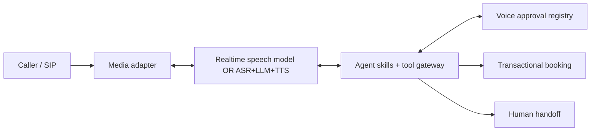

# Voice cloning and real-time runtime: deployment blueprint

## Choosing the right voice

| Choice | Does it replicate a real speaker? | Suggested use |
|---|---|---|
| Provider catalog voice | No | Default: fastest, minimal identity risk |
| Prompt-generated new synthetic voice | No existing speaker | Distinct brand voice where supported |
| Authorized recorded custom voice | Yes | Consent/verification-gated licensed voice |
| Live voice conversion | Possibly | Out of scope; treat speaker impersonation and verification as high risk |

**Recommended MVP:** start with an approved catalog voice, then add opted-in custom identity when needed. A voice clone is not required for reliable reception.

## Provider research (official documentation, checked November 2026)

### ElevenLabs
Instant Voice Cloning accepts owner-authorized audio through its interface. Professional Voice Cloning (PVC) is restricted to the speaker cloning their **own** voice and passing provider verification; the speaker can then use supported sharing functionality. Both verification and license/permission checks are important. Streaming speech synthesis uses WebSockets, but the `stream-input` endpoint has model-specific limits; confirm the exact model/version before wiring adapters.

- https://elevenlabs.io/docs/eleven-creative/voices/voice-cloning/
- https://elevenlabs.io/docs/eleven-api/guides/how-to/voices/professional-voice-cloning
- https://elevenlabs.io/docs/eleven-api/guides/how-to/websockets/realtime-tts

### OpenAI
Custom voices can be generated from descriptions (non-cloned synthetic voice) or approved recordings. **Recorded voice creation requires eligible project access, consent recording and reference sample from the same speaker.** Prompt-created voices and recording-created voices have different endpoint/model compatibility. Avoid assuming a custom voice will work across every realtime path.

- https://developers.openai.com/api/docs/guides/custom-voices
- https://developers.openai.com/api/docs/guides/realtime-conversations

## Data and consent model

Record in secure backend (no actual audio in repo):
```json
{
  "business_id": "demo-florist",
  "speaker_id": "pseudonymous-speaker",
  "provider": "approved-provider",
  "voice_id": "provider-opaque-id",
  "purpose": "inbound_receptionist",
  "consent_reference": "private-audit-record",
  "consent_verified": true,
  "provider_verified": true,
  "expires_at": "2030-01-31T00:00:00+00:00",
  "revoked": false
}
```
These fields must be set by an **authenticated trusted service**, never untrusted model output. Store evidence securely; enforce separate retention/deletion and revocation. Upon consent withdrawal: disable voice selection immediately and complete vendor retention/delete procedure.

## Streaming architecture and production concerns



- Session startup: resolve business tenant, confirm active voice approval, configure vendor voice before generation.
- Barge-in: cancel obsolete audio and discard stale model outputs; don't repeat cancelled confirmations.
- Preserve booking idempotency across voice interrupts and reconnects.
- Monitor per-tenant latency, audio dropout, availability, fallback and cost; run real tests to establish baselines.
- Require webhook authenticity, least privilege, TLS, per-tenant isolation, telephone-region review and human escalation.

## Current implementation scope

`receptionist/voices.py` is an **offline policy gate** with 11 unit tests; it is not a vendor API integration, voice cloning model, speaker-verification mechanism, or live call engine. No biometric material is included or processed.
